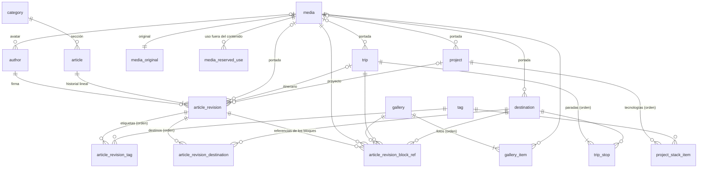

# Modelo de datos del CMS (PostgreSQL 18)

Esquema de las fases 6.1.2, 6.1.3 y 6.2. Representa el contrato de contenido que consume la web
(`src/app/content/records/records.ts`) con las reglas de `validate.ts`, sin simplificarlo.

- **Migraciones:** Flyway en `api/src/main/resources/db/migration/`:
  - `V1__catalogo.sql`: taxonomía, autoría, imágenes, galerías, lugares, itinerarios y proyectos.
  - `V2__articulos_y_revisiones.sql`: artículos, revisiones y sus elementos.
  - `V3__integridad.sql`: reglas entre tablas, imágenes retiradas, inmutabilidad, la operación de revisiones y los roles.
  - `V4__importacion.sql` (6.1.3): roles de importación, `import_published_article` y la protección de los punteros por identidad. Ver [`importacion-exportacion.md`](importacion-exportacion.md).
  - `V5__seguridad.sql` (6.2.1, **congelada**): permisos tras la separación de roles.
  - `V6__endurecimiento_session_user.sql` (6.2.1): las operaciones y reglas de contenido comprueban también `session_user` (el login real), y `PUBLIC` deja de tener `EXECUTE` en las funciones. Solo endurecimiento; no cambia el esquema de datos.
  - `V7__usuarios_y_sesiones.sql` (6.2.2): `app_user` y las tablas de Spring Session JDBC, con sus permisos. Ver [`seguridad.md`](seguridad.md).
  - `V8__passkeys_y_recuperacion.sql` (6.2.3): passkeys, identificador WebAuthn, challenges de un solo uso, procedencia del contador (solo inserción), códigos de recuperación (solo HMAC), fallos por sesión y `complete_passkey_enrollment` (dueño `cms_enrollment_writer`). Exige el rol `cms_enrollment_writer` (`infra/local/postgres-init/sql/cms-function-owners.psql`). Ver [`seguridad.md`](seguridad.md).
  - `V9__auditoria_intentos_y_dispositivos.sql` (6.2.4): auditoría de solo inserción (`audit_event`, `audit_event_ip`) con su purga `purge_audit` (dueño `cms_audit_retention`, ejecuta `cms_maintenance`), limitación de intentos (`login_attempt`) y dispositivos de confianza (`trusted_device`, `trusted_device_presentation`). No necesita roles nuevos. Ver [`seguridad.md`](seguridad.md).
  - `V10__publicacion.sql` (6.3.4): publicación con instantáneas. Ver [`publicacion.md`](publicacion.md).
  - `V11__publicacion_de_articulos.sql` (6.4.5): `publish_article` y `unpublish_article` (dueño `cms_article_publisher`), la única vía nueva hacia `published_revision_id`. Exige el rol `cms_article_publisher` (`infra/local/postgres-init/sql/cms-function-owners.psql`). Ver «Publicación de un artículo (V11)», abajo.
- **Roles y propiedad (6.2.1):** los crea el script de inicio `infra/local/postgres-init/`, una sola vez y como superusuario, nunca las migraciones.
  - `cms_owner` (sin login) es el propietario de la base de datos, del esquema `public` y de todo lo que crean las migraciones, salvo las funciones que V3 y V4 transfieren a `cms_revision_writer` y `cms_import_writer`.
  - Las migraciones las aplica `cms_migrator` (login `NOINHERIT`, miembro solo de `cms_owner` con `SET`), con `SET ROLE cms_owner` en cada conexión de Flyway. Sin ese `SET ROLE` no tiene ningún privilegio.
  - La API se conecta como `cms_api` (solo `cms_app`) y la herramienta de contenido como `cms_tool` (solo `cms_importer`). Ninguno puede crear objetos, migrar ni asumir `cms_owner`.
  - `PUBLIC` no tiene `CONNECT` ni `TEMPORARY` en la base de datos ni `USAGE` en el esquema.
  - Sin superusuario, `ALTER FUNCTION … OWNER TO` exige `CREATE` en el esquema para el nuevo dueño: el script de inicio lo concede a `cms_revision_writer` y `cms_import_writer` y V5 lo retira. Una migración futura que transfiera funciones a esos roles debe concederlo y retirarlo ella misma.

**Grafo de roles (verificado por `EffectivePrivilegeTests`):**

| Miembro             | Rol                                                               | INHERIT | SET | ADMIN | Motivo                                                        |
| ------------------- | ----------------------------------------------------------------- | ------- | --- | ----- | ------------------------------------------------------------- |
| `cms_api`           | `cms_app`                                                         | sí      | sí  | no    | Privilegios de la API                                         |
| `cms_tool`          | `cms_importer`                                                    | sí      | sí  | no    | Importación y exportación                                     |
| `cms_security_tool` | `cms_security_admin`                                              | sí      | sí  | no    | Herramienta de seguridad                                      |
| `cms_maintenance`   | `cms_audit_maintainer`                                            | sí      | sí  | no    | Retención de la auditoría                                     |
| `cms_migrator`      | `cms_owner`                                                       | **no**  | sí  | no    | Solo actúa como propietario con `SET ROLE` explícito          |
| `cms_owner`         | `cms_revision_writer`, `cms_import_writer`, `cms_audit_retention` | sí      | sí  | no    | Transferir funciones (SET) y gestionar sus permisos (INHERIT) |

- Cada rol de grupo tiene exactamente lo que se le concede directamente (o a `PUBLIC`) y lo que posee; cada login, exactamente lo de su rol; `cms_migrator`, sin `SET ROLE`, lo mismo que un login sin roles.
- **Por qué `cms_owner` necesita INHERIT:** tras transferir cada función, V3 y V4 hacen `REVOKE ALL … FROM PUBLIC` y `GRANT EXECUTE` sobre ella. Sin INHERIT, `cms_owner` no tiene privilegios sobre la función ya transferida y PostgreSQL ignora esos `REVOKE` con un aviso: la migración termina, pero `PUBLIC` conserva el `EXECUTE` de la importación y del núcleo de revisiones (comprobado). V1–V4 no se pueden modificar.
- **Consecuencia de esa herencia y su solución (V6):** `cms_owner` tiene `EXECUTE` en las funciones transferidas, así que una sesión de `cms_migrator` con `SET ROLE cms_owner` (o encadenando `SET ROLE` a sus dueños) podía usar las operaciones de negocio. V6 añade la comprobación de `session_user`, que `SET ROLE` no cambia:

| Operación o regla                  | `current_user` exigido | `session_user` (login) exigido |
| ---------------------------------- | ---------------------- | ------------------------------ |
| `import_published_article`         | (definidor)            | miembro de `cms_importer`      |
| `create_article_revision`          | (definidor)            | miembro de `cms_app`           |
| `restore_article_revision`         | (definidor)            | miembro de `cms_app`           |
| `insert_article_revision` (núcleo) | (definidor)            | `cms_app` o `cms_importer`     |
| INSERT en las tablas de revisión   | `cms_revision_writer`  | `cms_app` o `cms_importer`     |
| Cambio de `head_revision_id`       | `cms_revision_writer`  | `cms_app` o `cms_importer`     |
| Cambio de `published_revision_id`  | `cms_import_writer`    | `cms_importer`                 |

- Las reglas de los triggers se aplican en **todos** los caminos: funciones, DML directo o cadenas de `SET ROLE`. Verificado por `SessionUserAuthorizationTests` con conexiones reales.
- **Límite de confianza:** `cms_migrator` sigue siendo una credencial administrativa de confianza con capacidad de DDL: como propietario podría modificar estas funciones o desactivar los triggers. V6 impide usar las operaciones de negocio por los caminos normales; no protege frente al compromiso deliberado de una credencial capaz de modificar funciones o triggers (igual que la inmutabilidad de la auditoría).
- `PUBLIC` no tiene `EXECUTE` en ninguna función del esquema (V6), tampoco en las que creen migraciones futuras (privilegios por defecto). Las funciones de validación de los `CHECK` se conceden a `cms_app`, `cms_importer` y los roles dueños; `require_revision_writer`, solo a `cms_revision_writer`.
- **Extensiones:** ninguna salvo `plpgsql`.

## Entidades y relaciones

## Tablas (18 del modelo, más `flyway_schema_history`)

| Tabla                          | Contrato                                                  | Clave                     | Notas                                                                                                                          |
| ------------------------------ | --------------------------------------------------------- | ------------------------- | ------------------------------------------------------------------------------------------------------------------------------ |
| `category`                     | `CategoryRecord`                                          | `id` ∈ las 5 secciones    | `slug` único                                                                                                                   |
| `tag`                          | `TagRecord`                                               | `id`                      | `slug` único                                                                                                                   |
| `author`                       | `AuthorRecord`                                            | `id`                      | avatar → `media`                                                                                                               |
| `media`                        | `MediaRecord` sin `original`                              | `id`                      | `focal` obligatorio; `camera` JSONB; `location_lat`/`lng` NUMERIC(9,6) con ≤ 2 decimales; `credit_source_url` única; `retired` |
| `media_original`               | `MediaOriginal`                                           | `media_id`                | 1:1 obligatoria (al confirmar); `sha256` único; RAW: los tres campos o ninguno; datos privados                                 |
| `media_reserved_use`           | (código: `SECTIONS[].preview`)                            | `use_key`                 | protege las imágenes del menú                                                                                                  |
| `gallery`                      | `GalleryRecord`                                           | `id`                      | `slug` único                                                                                                                   |
| `gallery_item`                 | `GalleryRecord.items[]`                                   | `(gallery_id, position)`  | orden diferible                                                                                                                |
| `destination`                  | `DestinationRecord`                                       | `id`                      | `lat`/`lng` NUMERIC(9,6) con rango                                                                                             |
| `trip`                         | `TripRecord`                                              | `id`                      | `slug` único                                                                                                                   |
| `trip_stop`                    | `TripStopRecord`                                          | `(trip_id, stop_order)`   | orden diferible; `distance_km` numérico sin límite de decimales                                                                |
| `project`                      | `ProjectRecord`                                           | `id`                      | `slug` único                                                                                                                   |
| `project_stack_item`           | `ProjectRecord.stack[]`                                   | `(project_id, position)`  | orden diferible                                                                                                                |
| `article`                      | identidad de `ArticleRecord`                              | `id`                      | `slug` único; sección, orden, destacado, demo, fechas, punteros a revisiones                                                   |
| `article_revision`             | contenido de `ArticleRecord` + `ArticleBodyRecord.blocks` | `id`                      | **inmutable**; historial lineal                                                                                                |
| `article_revision_tag`         | `ArticleRecord.tags[]`                                    | `(revision_id, position)` | inmutable                                                                                                                      |
| `article_revision_destination` | `ArticleRecord.destinations[]`                            | `(revision_id, position)` | inmutable; `destinations_present` distingue ausente de `[]`                                                                    |
| `article_revision_block_ref`   | referencias dentro de `blocks`                            | `(revision_id, ref_path)` | inmutable; una fila por ocurrencia                                                                                             |

**Convenciones:**

- NULL en una columna opcional significa campo ausente en el JSON.
- `catalog_position` reproduce el orden de cada archivo JSON.
- Los textos usan el dominio `d_text` (no vacío) y los ids y slugs, `d_slug`.

**`demo`:** es `boolean NOT NULL` **sin valor por defecto** en las seis entidades del contrato que lo tienen: `media`, `gallery`, `destination`, `trip`, `project` y `article`. `noindex` no se guarda: la web lo deriva de `demo`.

## Orden dentro de cada contenedor

Todas las restricciones de orden son `DEFERRABLE INITIALLY DEFERRED`: se comprueban al confirmar la transacción, así que un intercambio o una renumeración no fallan a medio camino.

| Qué                                                       | Restricción                                                                                                                   |
| --------------------------------------------------------- | ----------------------------------------------------------------------------------------------------------------------------- |
| Artículos de una sección                                  | `UNIQUE (category_id, editorial_order)`. Los NULL son distintos, así que los borradores sin orden no chocan. Sin `btree_gist` |
| Fotos de una galería, paradas, tecnologías de un proyecto | PK `(contenedor, posición)`                                                                                                   |
| Elementos de cada colección                               | `UNIQUE (catalog_position)` por tabla                                                                                         |
| Etiquetas y destinos de una revisión                      | PK `(revision_id, position)`; inmutables                                                                                      |
| Bloques y fotos de una composición                        | orden del array JSONB                                                                                                         |

**Procedimiento para cambiar posiciones** (CMS):

1. Se envía la lista completa ordenada y la versión del contenedor.
2. El servidor comprueba que es el mismo conjunto.
3. Renumera de 1 a n en una transacción.
4. Si el contenedor cambió antes, da conflicto.

## Revisiones

**Escritura:** solo se escriben con dos funciones públicas.

| Función                                                           | Uso                                                                                                                            |
| ----------------------------------------------------------------- | ------------------------------------------------------------------------------------------------------------------------------ |
| `create_article_revision(article, parent, origin, content jsonb)` | Guardar (`origin` = `edit` o `import`). `content` es el contrato de `ArticleRecord` (sin los campos de identidad) más `blocks` |
| `restore_article_revision(revision, parent)`                      | Recuperar una revisión anterior como revisión **nueva** (N+1, `origin = 'restore'`, `restored_from_revision_id = N`)           |

**Las dos usan el mismo núcleo interno** (`insert_article_revision`), que en una sola transacción:

1. Valida el contenido: claves conocidas, obligatorias y tipos.
2. Bloquea el artículo y exige que `parent` sea la revisión de trabajo actual. Si no, devuelve `SQLSTATE CM409` (conflicto): nunca se sobrescribe ni se ramifica.
3. Inserta la revisión, sus etiquetas, sus destinos y una fila por cada referencia de los bloques.
4. Aplica la política de imágenes retiradas.
5. Mueve `head_revision_id`.

**Garantías:**

| Garantía                              | Cómo                                                                                                                                                                                                                                                                                                                                                     |
| ------------------------------------- | -------------------------------------------------------------------------------------------------------------------------------------------------------------------------------------------------------------------------------------------------------------------------------------------------------------------------------------------------------- |
| Ni modificar ni borrar                | Triggers `BEFORE UPDATE OR DELETE` y `BEFORE TRUNCATE` en las cuatro tablas de revisión                                                                                                                                                                                                                                                                  |
| Ningún elemento añadido después       | Sellado: los elementos solo se insertan en la transacción que creó la revisión (`article_revision.created_xact`, fijado por la base de datos). Vale también para el propietario                                                                                                                                                                          |
| Entrada única                         | Las inserciones exigen el indicador de transacción que activa solo la operación                                                                                                                                                                                                                                                                          |
| La aplicación no escribe directamente | El rol `cms_app` solo tiene `SELECT` en las tablas de revisión y `EXECUTE` en las dos funciones públicas. Tampoco puede cambiar `head_revision_id` ni `published_revision_id` (privilegios por columna)                                                                                                                                                  |
| Punteros protegidos por identidad     | Desde V4, el trigger `article_pointers_guard` solo deja cambiar `head_revision_id` a `cms_revision_writer` (dentro de las dos funciones) y `published_revision_id` a `cms_import_writer` (dentro de `import_published_article`). Vale también para el propietario de las tablas y no depende de variables de sesión. Un artículo nuevo nace sin punteros |
| Historial lineal                      | `UNIQUE (parent_revision_id)`; los punteros y los padres tienen FK compuesta al mismo artículo                                                                                                                                                                                                                                                           |

### Seguridad de las funciones `SECURITY DEFINER`

- **`search_path` fijado:** `pg_catalog, public, pg_temp` (temporales al final). Todos los objetos se nombran con su esquema y no hay SQL dinámico.
- **Propietario:** `cms_revision_writer`, un rol `NOLOGIN` que **no es superusuario**. Solo tiene:
  - `SELECT` en lo que consulta;
  - `INSERT` en las tablas de revisión;
  - `UPDATE (head_revision_id)` en `article`.
- **Ejecución:**
  - `EXECUTE` revocado a `PUBLIC`;
  - las funciones públicas, solo para `cms_app`;
  - el núcleo interno y `article_revision_content`, para nadie más.
- **Tests:** comprueban estas propiedades en `pg_proc`, y que una tabla temporal con el mismo nombre no desvía la función.

## Referencias y borrado

- **Restricción:** todas las FK hacia entidades reutilizables son `ON DELETE RESTRICT` (`SQLSTATE 23001`).
- **Composición:** solo el original de una imagen, los elementos de galería, las paradas y la pila de un proyecto usan `CASCADE` hacia su contenedor.
- **Rutas de referencia:** `article_revision_block_ref.ref_path` identifica cada ocurrencia, con índices desde 0 como en el validador.

| Bloque    | Rutas                                                                |
| --------- | -------------------------------------------------------------------- |
| `image`   | `blocks[i].media`                                                    |
| `figures` | `blocks[i].items[k].media` (una fila por foto, también si se repite) |
| `gallery` | `blocks[i].gallery`                                                  |
| `map`     | `blocks[i].trip` o `blocks[i].destinations[k]`                       |
| `chapter` | `blocks[i].destination`                                              |

Como las revisiones no se borran, **nada usado alguna vez por una revisión puede borrarse**. Para dejar de usar una imagen se retira.

### Imágenes retiradas

- **Regla:** un uso nuevo (insertar una referencia o cambiarla hacia una imagen con `retired = true`) falla. Se comprueba en:
  - avatar del autor;
  - portadas de lugar, itinerario y proyecto;
  - elementos de galería;
  - usos reservados;
  - portada de la revisión y referencias de imagen de los bloques.
- **Restaurar** una revisión que usa una imagen ahora retirada también falla, porque es un uso nuevo.
- **Referencias históricas:** las filas que ya la usaban siguen siendo válidas y se pueden modificar en otras columnas, reordenar o desvincular.

## Coordenadas

| Coordenadas                   | Tipo         | Base de datos                               | Backend antes de guardar (`CoordinatePolicy`) |
| ----------------------------- | ------------ | ------------------------------------------- | --------------------------------------------- |
| Lugares                       | NUMERIC(9,6) | rango geográfico                            | rechaza más de 6 decimales                    |
| Ubicación pública de una foto | NUMERIC(9,6) | rango, `x = round(x, 2)`, las dos o ninguna | rechaza más de 2 decimales                    |

PostgreSQL redondea en silencio al convertir a NUMERIC(9,6): `42.2900001` se guardaría como `42.29` y pasaría el CHECK. Por eso la validación previa del backend es imprescindible, y los tests documentan el redondeo.

## JSONB

| Columna                   | Motivo                                                                                                                                                              |
| ------------------------- | ------------------------------------------------------------------------------------------------------------------------------------------------------------------- |
| `article_revision.blocks` | Diez tipos polimórficos, siempre leídos y escritos enteros; es exactamente `ContentBlockRecord[]`. Sus referencias pasan a FK mediante `article_revision_block_ref` |
| `article_revision.seo`    | Distingue ausente (NULL) de `{}`; se ampliará en la fase 6.8                                                                                                        |
| `media.camera`            | Siete campos opcionales sin relaciones; distingue ausente de `{}`                                                                                                   |

**Limitaciones y validación:**

- El JSONB conserva los valores numéricos exactos y no conserva el orden de las claves, que no tiene significado. La exportación usará un orden canónico.
- La base de datos valida la forma estructural de los bloques: array no vacío y `type` conocido. La forma campo a campo la valida el backend al guardar y la puerta TypeScript al publicar.

## Reglas que siguen en la puerta de publicación (`integrity.ts`)

No caben en restricciones porque dependen del conjunto completo:

- toda imagen usada o retirada;
- toda galería usada;
- el destino de un capítulo debe ser parada o destino del artículo;
- ningún destino repetido;
- anclas y enlaces del HTML;
- ids de capítulo únicos y no reservados;
- paradas consecutivas 1…n y al menos dos;
- tiempo de lectura igual al calculado;
- una foto propia firmada por un autor de la revista.

## Pendiente en fases posteriores

- **6.2.1 (hecho):** la API se conecta como `cms_api` (miembro de `cms_app`), la herramienta de contenido como `cms_tool` (miembro solo de `cms_importer`) y las migraciones las aplica `cms_migrator` como `cms_owner`, que no es superusuario.
- **6.3 (6.3.4, hecho):** V10 añade la publicación con instantáneas: `content_publication` (historial de versiones con su matriz de transiciones), `content_publication_lease` (la época del fencing) y `content_publication_check` (resultado de la reconciliación). Diseño y permisos en [`publicacion.md`](publicacion.md).
- **6.4.5 (hecho):** la publicación de un artículo concreto desde el CMS (`published_revision_id`) con su propia operación y su propio rol definidor (V11).
- **6.4.6 y 6.4.7 (hecho):** etiquetas, autores, lugares, itinerarios y proyectos se crean, editan y borran desde el CMS **sin migración**, con los privilegios de `cms_app` desde V3. La concurrencia usa `xmin` como token opaco (sin columnas nuevas) y las claves foráneas RESTRICT siguen siendo la última barrera ([`cms-api.md`](cms-api.md)).

## Publicación de un artículo (V11, fase 6.4.5)

Dos operaciones `SECURITY DEFINER`, con dueño `cms_article_publisher` (sin login, miembro solo
`cms_owner`, con INHERIT y SET) y `EXECUTE` solo para `cms_app`. Las dos exigen que el
`session_user` sea de la API, como en V6.

| Operación                                      | Qué hace                                                                                                                                                                                                                                                                                                                                                                                                                                    |
| ---------------------------------------------- | ------------------------------------------------------------------------------------------------------------------------------------------------------------------------------------------------------------------------------------------------------------------------------------------------------------------------------------------------------------------------------------------------------------------------------------------- |
| `publish_article(artículo, revisión, versión)` | Con el artículo bloqueado, comprueba la versión (`lock_version`, si no CM412), que la revisión es del artículo (22023) y que es su revisión de trabajo (CM409), y la marca como publicada. La primera vez fija `published_at` a la fecha de hoy en Europe/Madrid y, si no tiene orden, el siguiente de su sección (bloqueo asesor 0x434D53/65, compartido con la reordenación). Sube `lock_version`. Si ya era la publicada, no cambia nada |
| `unpublish_article(artículo, versión)`         | Misma comprobación de versión; quita la revisión publicada y conserva `published_at` y el orden                                                                                                                                                                                                                                                                                                                                             |

- **Permisos de `cms_article_publisher`:** `USAGE` en el esquema; `SELECT` de `article` (`id`,
  `head_revision_id`, `published_revision_id`, `category_id`, `editorial_order`, `lock_version`,
  `published_at`); `UPDATE` de `article` (`published_revision_id`, `published_at`,
  `editorial_order`, `lock_version`); `SELECT` de `article_revision` (`id`, `article_id`). Nada
  más: ni privilegios de tabla, ni `CREATE`, ni pertenencias (`ArticlePublishingSchemaTests`).
- **Guarda de los punteros (`guard_article_pointers`):** la de V6 más una sola vía nueva:
  `published_revision_id` también lo cambia `cms_article_publisher` desde una conexión de la API.
  Siguen rechazados:
  - el DML directo de `cms_app` (sin privilegio de columna);
  - el propietario, incluso asumiendo el rol dueño;
  - cualquier sesión que no sea de la API.
- **Volúmenes ya inicializados:** antes de migrar, ejecutar `cms-function-owners.psql` (como en V8,
  `infra/local/README.md`). Sin el rol, V11 se detiene y Flyway la revierte entera.
